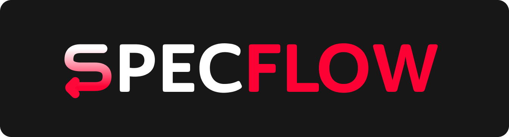

# SPECFLOW

## Описание

SpecFlow — сервис автоматического извлечения и нормализации характеристик товаров
из полуструктурированных карточек продавцов. Решение превращает «сырую» карточку
в аккуратный набор характеристик с оценкой уверенности для каждой: заполненные
атрибуты выводят товар в фильтры поиска, что напрямую влияет на CTR, конверсию и GMV.

**Вход → выход:**

- **Вход** — текст карточки товара: название, описание и текстовые атрибуты продавца.
  Изображения не используются.
- **Выход** — структурированный JSON с выделенными атрибутами, где для каждого
  указаны каноническое значение и уверенность модели (например: бренд `Samsung`,
  объём памяти `256 ГБ`, диагональ экрана `6,7 дюйма`, цвет `чёрный`).

### Проблема

Карточки продавцов заполнены неровно: важные характеристики спрятаны в свободном
тексте, записаны по-разному («алый», «красный», «red»; «8 ГБ», «8GB», «8128 МБ»)
или отсутствуют в структурированных полях. Незаполненный атрибут ломает фильтры
поиска, сопоставление одинаковых товаров разных продавцов, рекомендации и
ценообразование. Дополнительные сложности — огромная таксономия, длинный хвост
редких значений и постоянное появление новых товаров и категорий.

### Что делает сервис

1. Определяет перечень атрибутов для категории товара.
2. Извлекает значения атрибутов из текста карточки.
3. Приводит значения к каноническому виду (единицы измерения, синонимы, регистр).
4. Сопоставляет значения со справочником допустимых значений.
5. Возвращает результат с оценкой уверенности; сомнительные случаи помечает как
   требующие ручной проверки.

## Как это работает

Пайплайн построен как **гибридный каскад** (cheap-first): дешёвые методы закрывают
типовые случаи, дорогие подключаются только там, где без них не справиться.

```
текст карточки
  → препроцессинг и определение схемы категории
  → правила и словари (регулярные выражения, синонимы, единицы)
  → ML-экстракторы (NER, классификатор, дообученный трансформер)
  → LLM (zero-/few-shot) — только при необходимости
  → объединение кандидатов
  → проверка подтверждения в тексте (grounding)
  → нормализация значений
  → расчёт уверенности и фильтрация по порогу
  → JSON с атрибутами
```

## Пример результата

Для карточки смартфона (`POST /api/v1/extract`):

```json
{
  "product_id": "sm-001",
  "attributes": [
    {"attribute_code": "brand", "normalized_value": "Samsung", "confidence": 0.98},
    { "attribute_code": "storage_gb", "normalized_value": "256 ГБ", "confidence": 0.95 },
    { "attribute_code": "diagonal_inches", "normalized_value": "6,7 дюйма", "confidence": 0.93 },
    { "attribute_code": "color", "normalized_value": "чёрный", "confidence": 0.81 }
  ],
  "status": "ok",
  "needs_review": false,
  "pipeline_version": "0.1.0"
}
```

## Архитектура

```
specflow/
├── pyproject.toml            # корневой uv-workspace и dev-зависимости
├── docker-compose.yml        # сборка и запуск всего стека
├── nginx/nginx.conf          # reverse-proxy: единая точка входа
└── services/
    ├── frontend/             # React + TypeScript + Vite (i18next)
    ├── api_gateway/          # FastAPI — публичный API
    ├── attribute_extractor/  # FastAPI — извлечение атрибутов
    └── contracts/            # общие доменные модели и Pydantic-схемы
```

Запросы снаружи приходят на nginx (порт 80): `/` проксируется на фронтенд,
`/api/` — на API Gateway. Сервис `attribute_extractor` доступен только внутри
docker-сети и содержит пайплайн извлечения; API Gateway — публичное лицо бэкенда.

## Требования

- Python 3.13
- [uv](https://docs.astral.sh/uv/)
- Node.js 22+ (для локальной разработки фронтенда)
- Docker и Docker Compose

## Начало работы

### 1. Клонируйте репозиторий

```bash
git clone https://github.com/Mitoshi-Team/specflow
cd specflow
```

### 2. Создайте .env на основе .env.example

```bash
cp .env.example .env
```

При необходимости отредактируйте переменные.

### 3. Установите pre-commit хуки

```bash
uv tool install pre-commit
pre-commit install
```

### 4. Установите зависимости бэкенда

```bash
uv sync
```

Команда создаёт общее виртуальное окружение `.venv` и устанавливает оба сервиса
(`api_gateway`, `attribute_extractor`), общий пакет контрактов
(`specflow_contracts`) вместе с dev-зависимостями (ruff, pytest).

### 5. Запустите docker

```bash
docker compose up --build -d
```

Сайт будет доступен на `http://localhost` (порт задаётся переменной `NGINX_PORT`).

Для остановки используйте

```bash
docker compose down
```

## Структура сервисов

| Сервис | Технологии | Порт в контейнере |
| --- | --- | --- |
| `nginx` | nginx | 80 |
| `frontend` | React, TypeScript, Vite, i18next | 5173 |
| `api_gateway` | FastAPI, uvicorn | 8000 |
| `attribute_extractor` | FastAPI, uvicorn | 8001 |

## API

Публичный API отдаётся API Gateway под префиксом `/api/v1`. Полный контракт —
в [`api_contract.md`](openspec/specs/api_contract.md).

| Метод | Путь | Описание | Статус |
| --- | --- | --- | --- |
| GET | `/api/v1/health` | Проверка работоспособности | реализовано |
| POST | `/api/v1/extract` | Извлечение атрибутов для одной карточки | запланировано |
| POST | `/api/v1/extract/batch` | Пакетное извлечение по нескольким карточкам | запланировано |
| GET | `/api/v1/categories` | Список категорий со схемами атрибутов | запланировано |
| GET | `/api/v1/categories/{category}` | Схема атрибутов конкретной категории | запланировано |
| GET | `/api/v1/info` | Версия сервиса и пайплайна, доступные методы | запланировано |
| GET | `/api/v1/config` | Текущая конфигурация пайплайна (read-only) | запланировано |

## Полезные команды

### Бэкенд

```bash
uv run pytest              # все тесты бэкенда
uv run ruff check          # линт
uv run ruff format         # форматирование
uv run uvicorn api_gateway.main:app --reload         # запуск API Gateway
uv run uvicorn attribute_extractor.main:app --port 8001 --reload  # запуск экстрактора
```

### Фронтенд

```bash
cd services/frontend
npm install
npm run dev        # dev-сервер Vite (http://localhost:5173)
npm run build      # проверка типов и production-сборка
```

Если нужно сбросить окружение: удалите `.venv` и выполните `uv sync` заново.
